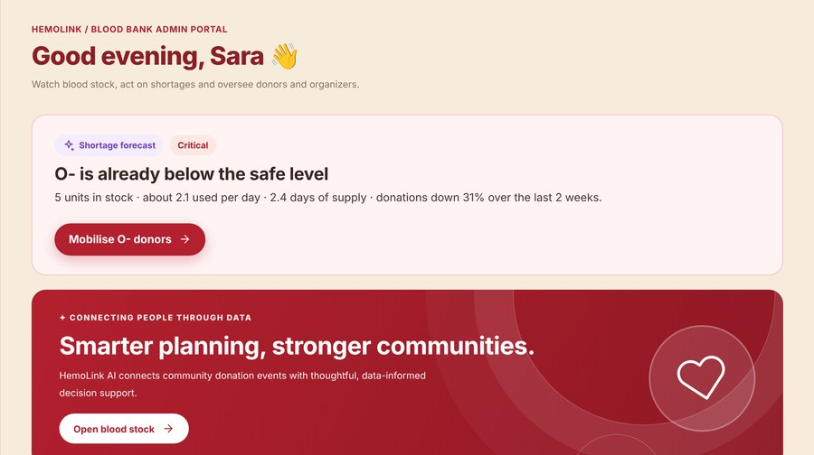
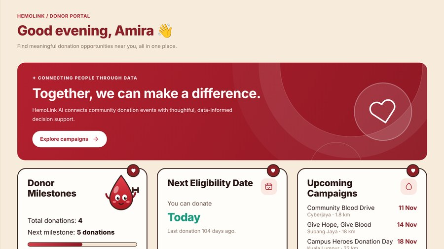
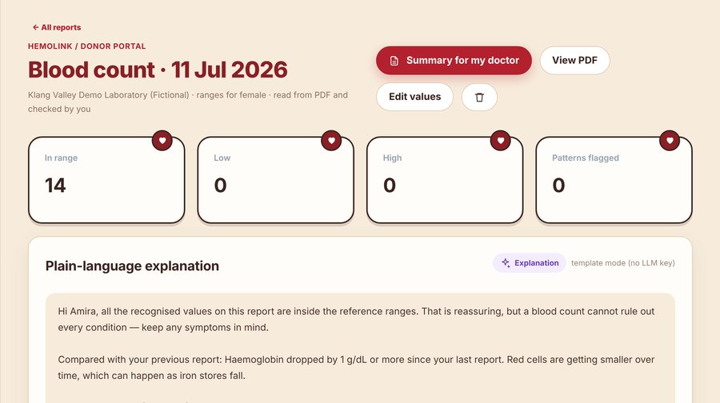

# HemoLink AI

**See a blood shortage coming — and reach the donors most likely to come.**

HemoLink AI is a web app (it also installs on phones) that connects the three people a blood supply depends on:
**donors**, the **community groups that run blood drives**, and **blood bank staff**. It forecasts which blood types
are running low, alerts only the donors most likely to help, checks donor eligibility against the National Blood
Centre's (PDN) rules, and helps donors understand their own blood tests — in English and Bahasa Malaysia.

Built for **DSH Hacks V2 (AI × Healthcare)** · Python FastAPI · SQLite · scikit-learn · HTML/CSS/JavaScript ·
optional Gemini / Claude / OpenAI for plain-language explanations.

<!-- Live demo: add the Render link here after deploying -->
Judges and first-time visitors: see **`docs/submission/HemoLink-judges-quickstart.pdf`** for a 2-minute tour.

| Blood bank | Donor | HemoScan |
|---|---|---|
|  |  |  |

---

## Who uses it

| Role | Who | What they do in HemoLink |
|---|---|---|
| **Donor** | Anyone — every new account starts as a donor | Find drives on a map, check eligibility, book a slot, answer urgent requests, read their blood tests (HemoScan), keep a medicine list (HemoCare), ask the assistant |
| **Drive organizer** | Universities, companies, NGOs approved by the blood bank | Create drives and pin them on a map, check donors in, see turnout and ratings, plan where and when to hold the next drive |
| **Blood bank admin** | Blood bank staff, e.g. at a PDN centre | Watch stock and the 7-day shortage outlook, send urgent requests to matched donors, record donations, approve organizers, review the AI models |

Organizers and admins can **never** see a donor's HemoScan reports or medicine list. Organizers also can't see stock
or urgent requests.

## How it works — the loop

1. **Forecast.** Every blood type's stock is projected 7 days ahead from expected donations and use. Types that will
   fall below their safe level are flagged on the admin dashboard, with the reason.
2. **Match.** The admin posts an urgent request. HemoLink ranks compatible donors who are eligible today and alerts
   just enough of them (units needed × 1.5) instead of everyone.
3. **Reach.** Donors get the alert in the app, and by email, SMS or phone push if they turned those on.
4. **Respond.** The donor taps *I can come*, checks today's eligibility questions and books a slot at a drive.
5. **Donate.** The organizer (or admin) marks the donation at check-in. Stock goes up, the donor's next eligible date
   is set, and they get a reminder when they can donate again.
6. **Learn.** Replies and donations feed the models: who tends to reply, who is drifting away, and where the next
   drive will find the most eligible donors.

## Features

### Shortage outlook and donation trends
- 7-day stock projection for all 8 blood types against each type's safe level, with days of supply and recent trend.
- **Donation Trends** shows Ministry of Health daily donation data for Malaysia and each state, with a 7-day forecast
  and how accurate the chosen method has been.
- Admins can edit stock levels; donations recorded in the app update stock automatically.

### Urgent requests and smart donor matching
- Filters donors by blood-type compatibility, today's eligibility and medicine waiting periods.
- Scores each donor (distance, past reply rate, exact type, regular donor, recent alerts, no-shows) and shows the
  reasons behind every score.
- Sends alerts, tracks *yes / no* replies and marks donations. *Simulate donor replies* fills in the demo's
  synthetic donors.

### Eligibility check (PDN rules)
- Rules from Pusat Darah Negara's donor registration form and FAQ (checked Nov 2026; sources on the page):
  age 17 (with a parent's written consent) to 65, first-time donors up to 60, regular donors 66–70 with a yearly
  check-up; weight ≥ 45 kg; haemoglobin ≥ 12.5 g/dL on the day; men every 3 months, women every 4.
- 15 quick questions from the PDN form — e.g. antibiotics (2 weeks), dental treatment (24 h), tattoo, piercing,
  bekam or acupuncture (6 months), dengue (6 months), surgery or transfusion (6 months), vaccines (staff check).
- **The rules decide; AI only explains** the result in plain language. The doctor at the drive makes the final call.

### Campaigns, map and planner
- Map of drives (OpenStreetMap), **Use my location**, distance and rough drive time, 10 / 25 / 50 km filters,
  directions, booking with time slots, cancellation and ratings.
- Organizers create drives with a **map picker** (search the venue, use GPS, or drag the pin) and can edit the
  location later. Donors within 25 km who opted in are told about new drives.
- **Insights & Planner** for organizers: turnout, no-show rate, ratings, regular donors who are drifting away
  (with a suggested message), and where and on which weekday to hold the next drive.

### HemoScan AI — understand your blood test
1. **Read** — upload the lab PDF, take a photo of a paper report (OCR), or type values in. It finds 20 common
   tests (Hb, MCV, platelets, white cell types…), their units and the lab's reference ranges, and converts SI units.
2. **Check** — the donor compares every value with the original (shown side by side) and fixes anything wrong.
   Photo and scanned readings are always marked *Check*.
3. **Analyse** — 17 transparent rules flag out-of-range values and known combinations (e.g. a microcytic pattern,
   or low platelets with low white cells as seen in dengue), each with *why it fired* and references.
4. **Explain** — AI (or a built-in template) explains the findings in plain language, compares them with earlier
   reports, and suggests questions for the doctor. **Never a diagnosis.**

Reports are private to the donor, their files are encrypted, results can be exported as CSV, and there is a
printable **Summary for my doctor**.

### HemoCare — blood health hub
- **Medical Knowledge**: 9 plain-language guides (anaemia, iron deficiency, thalassaemia, platelets, dengue, B12 and
  folate, white cells, blood pressure, medicines and donating), each with *what it means for donating* and *when to
  get urgent care*.
- **Medication History**: a private medicine list. Medicines with a donation waiting period (e.g. antibiotics,
  isotretinoin, blood thinners) pause the eligibility check and urgent alerts until the wait is over.
- **Donation Preparation**: checklist and a printable summary to show the screening staff.

### Alerts and reminders
| Who | Gets |
|---|---|
| Donor | Urgent requests · booking confirmed / cancelled · reminder the day before · "you can donate again" · new drive nearby · donation recorded |
| Organizer | Donor booked / cancelled · donor feedback · organizer role approved |
| Admin | A donor replied *I can come* · delivery log with **Run reminders now** and **Send me a test** |

Channels: in-app, email (any SMTP server), SMS or WhatsApp (Twilio), and phone/browser push. Each person chooses
in **My Profile → Alerts & language**. Without email/SMS settings the app runs in **demo mode**: messages are listed
in the admin's delivery log instead of being sent. Reminders run every 15 minutes while the server is up.

### Health assistant
Answers questions about donating, preparing and booking. Medical and off-topic questions are blocked before they
reach the AI; without an AI key it answers from a built-in FAQ. It introduces itself as *HemoLink Assistant*.

### Bahasa Malaysia
An **EN | BM** switch on the sign-in page, the top bar and the profile. Menus, buttons, forms, dates, alerts and AI
answers follow the chosen language. Names, campaign text, medical guides and HemoScan findings stay in English
(a note says so).

### Privacy and security (PDPA 2010)
- Consent to the privacy notice at sign-up and for every HemoScan upload, recorded with version and time.
- **Download my data** (JSON) and **Delete my account** in My Profile.
- Report files encrypted at rest; original files deleted after 12 months (confirmed values stay); delivery log kept
  90 days.
- Role checks on every request, rate limits, a 15-minute lock after 5 wrong passwords, strict security headers,
  signed session cookies. Privacy notice: `static/privacy.html`.

## How the AI is built and tested

| Model | What it does | How it's checked |
|---|---|---|
| **Forecasting** (`forecast.py`, `ai/stock.py`) | Per region × blood group, three methods compete: same weekday last week, 4-week weekday average, Random Forest | Rolling-origin cross-validation (7-day horizon); lowest error wins, the simpler method wins ties. On MOH data the chosen method is **27% more accurate** than "same weekday last week" across 70 series |
| **Donor matching** (`ai/matching.py`) | Transparent weighted score | **Fairness check**: every centre × blood type simulated; selection rates by age band, area and distance compared with the four-fifths rule. Donors 45+ are picked slightly less often (0.75–0.79) — explained mainly by distance and donation history; age itself is not scored |
| **Donor return** (`ai/churn.py`) | Logistic regression: will this donor come back? | 5-fold cross-validation: AUC 0.85, Brier score 0.145 (vs 0.213 baseline), calibration and results by age band and area |
| **Language model** (`ai/llm.py`) | Explains eligibility results and HemoScan findings, answers the assistant | Never decides anything. Guardrails first, template fallback on any error; Admin → **AI Models** → **Test AI connection** checks the key without showing it |

Full results: Admin → **AI Models**, and `docs/MODEL_REPORT.md` (written by `scripts/train_models.py`).

## Run it on your computer

From the `hemolink` folder (Windows, Anaconda or VS Code terminal):

```powershell
conda create -n hemolink python=3.11 -y
conda activate hemolink
pip install -r requirements.txt
python scripts/train_models.py     # optional, ~2 min: trains and saves the forecasting models
uvicorn app:app --reload
```

Open **http://127.0.0.1:8000** (API docs: `/api/docs`). Without Anaconda: `py -3.11 -m venv .venv`,
`.venv\Scripts\activate`, then the same `pip` and `uvicorn` lines.

**Demo accounts** — one click on the sign-in page, or password `Demo123!`:

| Role | Login | Who |
|---|---|---|
| Donor | `donor@demo.com` | Amira Hassan · O− · Cyberjaya |
| Drive organizer | `organizer@demo.com` | Daniel Lim · community drives around Kuala Lumpur |
| Blood bank admin | `admin@demo.com` | Dr. Sara Tan · HemoLink Centre Kuala Lumpur |

On first start the app also creates 300 synthetic donors (they can't log in), 180 days of simulated stock movements
and past alert replies, so the AI features have data to work with. The data lives in `hemolink_v2.db`; delete it
while the server is stopped to start fresh.

**Optional settings** go in a `.env` file next to `app.py` — copy `.env.example`, which explains each one:
AI key (Gemini, Claude or OpenAI), email (SMTP), SMS (Twilio), push keys, the app's public link and data-protection
options. Step-by-step setup for email, SMS and push on a real phone: **`docs/SETUP_GUIDE.md`**.

**Photo reading (OCR)** uses RapidOCR (`rapidocr_onnxruntime`, about 60 MB). If it won't install, remove that line
from `requirements.txt`; photos then fall back to typing the values in.

## Data

- **Donations:** Ministry of Health Malaysia / National Blood Centre, *Daily Blood Donations by Blood Group & State*
  (`data/donations_state.csv`, 2006 – Oct 2026, CC BY 4.0). `python scripts/download_data.py` fetches the latest.
  It reports donations collected only, so blood **stock and usage are simulated**.
- **Demo records:** centres, synthetic donors, stock movements and alert replies are fictional.

## Put it online

See **`DEPLOY.md`**: a phone demo in 5 minutes with a free HTTPS tunnel, a permanent free link on Render
(`render.yaml` is ready), or any Docker host (`Dockerfile`).

## Project structure

```text
hemolink/
├── app.py               # accounts, campaigns, bookings, stock, notifications, security middleware
├── ai_routes.py         # outlook, urgent requests + matching, eligibility, reports, AI models page
├── hemoscan_routes.py   # HemoScan: upload, photo, check, analyse, history, export, doctor summary
├── hemocare_routes.py   # HemoCare: guides, medicine list, donation preparation
├── notify_routes.py     # alert settings, push devices, delivery log, scheduled reminders
├── privacy_routes.py    # download my data, delete my account, consents, data retention
├── notifier.py          # email / SMS / push delivery, English + Malay message templates
├── security.py          # rate limits, login lock, file encryption, security headers
├── forecast.py          # forecasting methods + cross-validation (shared by Trends and the outlook)
├── seed.py              # demo data: synthetic donors, stock history, reply history
├── ai/                  # matching, eligibility, churn, stock, evaluation, assistant, llm
│   ├── hemoscan/        # biomarkers, PDF extraction, OCR, rules, explanations, sample reports
│   └── hemocare/        # medical guides, medicine waiting periods
├── static/              # index.html, app.js, hemoscan.js, hemocare.js, alerts.js, i18n.js, sw.js, style.css, privacy.html
├── scripts/             # download_data.py, train_models.py
├── data/ · models/      # MOH donation data · saved forecasting models + metrics.json
├── docs/                # MODEL_REPORT.md, SETUP_GUIDE.md, VERSION_HISTORY.md, submission/
└── tests/               # 55 automated tests
```

## API overview

All write requests need the header `X-HemoLink-Request: app`; sessions use signed cookies. Full list: `/api/docs`.

| Area | Endpoints |
|---|---|
| Accounts | `POST /api/signup` · `POST /api/login` · `POST /api/logout` · `GET/PATCH /api/me` · `PATCH /api/me/lang` |
| Campaigns | `GET/POST /api/campaigns` · `PATCH /api/campaigns/{id}/location` · `POST /api/bookings` · `POST /api/feedback` · `POST /api/organizer/bookings/{id}/status` |
| Stock and requests | `GET /api/outlook` · `GET /api/forecast` · `GET/POST /api/requests` · `POST /api/requests/{id}/alerts\|simulate\|close` · `POST /api/alerts/{id}/respond\|donated` |
| Eligibility and AI | `GET /api/eligibility` · `POST /api/eligibility/check` · `POST /api/assistant` · `GET /api/models` · `POST /api/admin/llm/test` |
| HemoScan | `POST /api/hemoscan/reports/upload\|photo\|manual` · `GET /api/hemoscan/reports` · `POST /api/hemoscan/reports/{id}/confirm\|ask` · `GET /api/hemoscan/reports/{id}/summary` · `GET /api/hemoscan/export.csv` |
| HemoCare | `GET /api/hemocare/overview` · `GET/POST /api/hemocare/meds` · `GET /api/hemocare/prep` |
| Alerts | `GET/PUT /api/notify/settings` · `POST/DELETE /api/push/subscribe` · `POST /api/notify/test` · `GET /api/admin/outbox` · `POST /api/admin/jobs/run` |
| Privacy | `GET /api/me/export` · `GET /api/me/consents` · `DELETE /api/me` |

## Tests

```powershell
python -m pytest -q
```

55 tests cover accounts and roles, booking, the AI features, PDN eligibility rules, forecasting and model selection,
fairness evaluation, HemoScan (PDF, SI units, scanned and photo reports, privacy), HemoCare, alerts in both
languages, the map picker, security (rate limits, login lock, encryption, headers) and personal-data export and
deletion.

## Limitations

- **A student prototype, not a medical device.** Screening staff and doctors make every decision.
- HemoScan rules, urgent thresholds and medical guides need review by a clinician before real use. PDN doesn't
  publish waiting periods for most medicines, so those (other than antibiotics) are examples.
- Before real patients: a managed database with backups, encryption of the database itself, an audit log of staff
  access, and a privacy notice reviewed by the blood bank's data protection officer.

## Licence and credits

HemoLink AI is licensed under the **GNU AGPL-3.0-or-later** (`LICENSE`; credits in `NOTICE.md`). HemoScan reads PDFs
with PyMuPDF, which is AGPL-licensed. If you host a changed version, set `HEMOLINK_SOURCE_URL` to your public
repository — the app's **Source code** links point there. Donation data © Ministry of Health Malaysia (CC BY 4.0);
maps © OpenStreetMap contributors; Leaflet (BSD-2-Clause).

Version-by-version build notes: `docs/VERSION_HISTORY.md`.